<div align="center">


# MiSide Peace Mode

MiSide (AIHASTO) 0.93L용 BepInEx 6 IL2CPP 플러그인<br>
한국어 · English · 日本語 · 中文

</div>

> **비공식 팬 모드입니다.** AIHASTO가 준비 중인 공식 '평화 모드'가 아니며, AIHASTO와 아무 관련이 없습니다. MiSide © AIHASTO.<br>
> **Unofficial fan mod.** Not AIHASTO's official Peaceful Mode and not affiliated with AIHASTO.

<!-- languages -->
**한국어** · [English](docs/i18n/README.en.md) · [日本語](docs/i18n/README.ja.md) · [简体中文](docs/i18n/README.zh-Hans.md) · [繁體中文](docs/i18n/README.zh-Hant.md) · [Русский](docs/i18n/README.ru.md) · [Русскій (дореформенный)](docs/i18n/README.ru-old.md) · [Українська](docs/i18n/README.uk.md) · [Беларуская](docs/i18n/README.be.md) · [Български](docs/i18n/README.bg.md) · [Қазақша](docs/i18n/README.kk.md) · [Srpski](docs/i18n/README.sr-Latn.md) · [Hrvatski](docs/i18n/README.hr.md) · [Čeština](docs/i18n/README.cs.md) · [Slovenčina](docs/i18n/README.sk.md) · [Polski](docs/i18n/README.pl.md) · [Magyar](docs/i18n/README.hu.md) · [Română](docs/i18n/README.ro.md) · [Deutsch](docs/i18n/README.de.md) · [Français](docs/i18n/README.fr.md) · [Italiano](docs/i18n/README.it.md) · [Español](docs/i18n/README.es.md) · [Español (Latinoamérica)](docs/i18n/README.es-419.md) · [Português (Portugal)](docs/i18n/README.pt.md) · [Português (Brasil)](docs/i18n/README.pt-BR.md) · [Svenska](docs/i18n/README.sv.md) · [Türkçe](docs/i18n/README.tr.md) · [Bahasa Indonesia](docs/i18n/README.id.md) · [Filipino](docs/i18n/README.fil.md) · [Tiếng Việt](docs/i18n/README.vi.md) · [ไทย](docs/i18n/README.th.md) · [العربية](docs/i18n/README.ar.md) · [العربية (مصر)](docs/i18n/README.ar-EG.md) · [فارسی](docs/i18n/README.fa.md)
<!-- /languages -->

**⬇ [설치 프로그램 내려받기 · Download the installer](https://github.com/O3O-2022/MiSide-PeaceMode/releases/latest)** · **▶ [영상 · Video](https://youtu.be/mswlea_Ozpg)** · [설치 방법](#설치) · [Install (English)](#english--日本語--中文)

## 개요

- 메인 메뉴의 **평화 모드** 버튼으로, 공포 전개 없이 미타와 하루를 보내는 모드입니다.
- 7명의 미타 중 한 명을 골라 대화 · 교감 · 선물 · 놀이 · 식사 · 잠자기 · 소파 · 음악을 함께하고, 미타가 먼저 뭔가 하자고 하기도 합니다. 날씨와 계절이 바뀌고, 미타는 화면 밖의 현실(종료 방식, 요일, 생일, 노트북 배터리…)에도 반응합니다.
- 미타의 동작은 원작 여러 챕터의 애니메이션(엔딩의 포옹, 잠꾸러기 미타의 잠, 백룸의 손 잡기 등)을 가져와 씁니다.
- 대사는 한국어 · 영어 · 일본어 · 중국어(간체)로 나옵니다. 한국어 대사는 게임 공식 번역의 캐릭터별 말투를 따르고, 게임 텍스트 자체는 수정하지 않습니다.
- 아래 GIF는 모두 실제 게임에서 메뉴를 고르는 장면부터 찍은 것입니다.

**목차** — [미타 선택](#미타-선택) · [대화하기](#대화하기) · [교감하기](#교감하기) · [선물하기](#선물하기) · [같이 놀자](#같이-놀자) · [캐피의 미니게임](#캐피의-미니게임) · [같이 다니자](#같이-다니자) · [특별한 시간](#특별한-시간) · [몸짓과 시선](#몸짓과-시선) · [집 안 물건 · 부탁 · 일기](#집-안-물건--부탁--일기) · [미타가 먼저](#미타가-먼저) · [호감도](#호감도) · [하루 일과](#하루-일과) · [소파](#소파) · [날씨와 계절](#날씨와-계절) · [현실 연동 이벤트](#현실-연동-이벤트) · [착한 미타의 본편 기억](#착한-미타의-본편-기억) · [언어](#언어) · [AI 자유 대화](#ai-자유-대화) · [설치](#설치) · [조작 · 설정](#조작--설정)

---

## 미타 선택

<div align="center">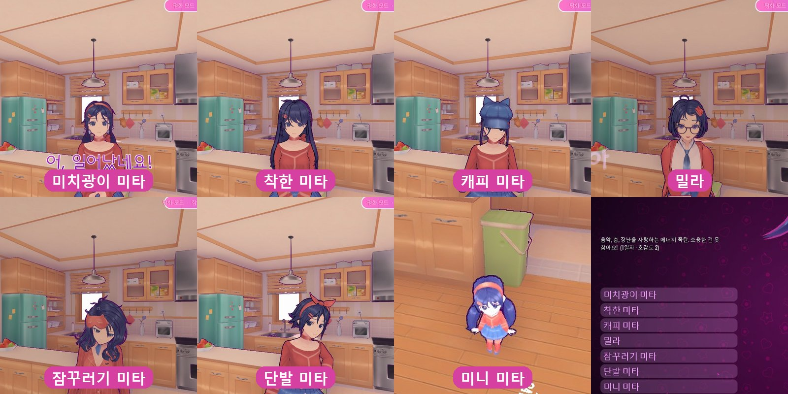</div>

메인 메뉴 → 평화 모드 → 미타 선택. 미타마다 외형(머리카락 · 치마 물리 포함), 대기 모션, 말할 때 몸짓, 목소리 높낮이, 말투, 걷는 속도, 취침 · 기상 시각, 호감도 증가 속도, 고유 행동, 좋아하는 선물이 다르고, 진행도는 미타별로 따로 저장됩니다.

| 미타 | 성격 | 고유 행동 | 좋아하는 선물 | 특징 |
|---|---|---|---|---|
| 미치광이 미타 | 원작의 미타. 다정하지만 집착이 강함 | 손 잡기 | 꽃 | 화가 나면 화면이 붉게 깜빡임 |
| 착한 미타 | 차분한 엔지니어, 리더 | 고민 상담 | 커피 | 본편 진행도를 기억함, 6시 기상 22시 취침 |
| 캐피 | 음악과 장난을 좋아하는 활발한 성격 | 기타 연주 | 카세트 테이프 | 댄스 배틀 · 망치 게임, 고개 따라 하기 |
| 밀라 | 까칠한 책벌레 | 티타임 | 책 | 호감도가 느리게 오르고, 낮으면 쓰다듬기 · 안기 거절 |
| 잠꾸러기 미타 | 늘 졸린 성격 | 커피 타 주기 | 인형 | 낮잠 가능, 19시 취침 |
| 단발 미타 | 신생 미타들을 돌보는 선생님 | 세계 강의 | 책 | — |
| 미니 미타 | 체크포인트의 성격 급한 꼬마 조수 | 지능 체크 퀴즈 | 초콜릿 | 작은 체구, '플레이어님'이라 부름 |

<table>
<tr>
<td align="center">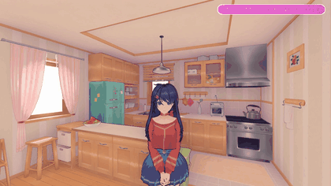<br><b>착한 미타 · 고민 상담</b><br>고민을 들어 주고 엔지니어답게 정리해 줍니다.</td>
<td align="center">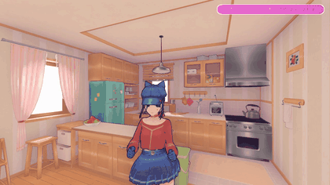<br><b>캐피 · 기타 연주</b><br>원작 7장의 연주 동작으로 한 곡 들려줍니다.</td>
</tr>
<tr>
<td align="center">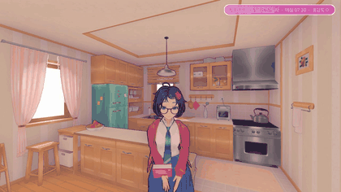<br><b>밀라 · 티타임</b><br>차를 내려 주며 까칠하게 말을 겁니다.</td>
<td align="center">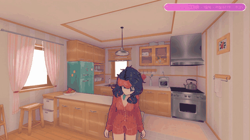<br><b>잠꾸러기 미타 · 커피</b><br>커피를 타 주면 한동안 덜 졸립니다.</td>
</tr>
<tr>
<td align="center">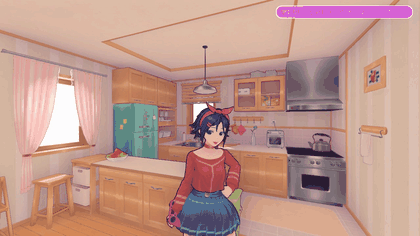<br><b>단발 미타 · 세계 강의</b><br>원작 10장의 강의 몸짓으로 세계를 설명합니다.</td>
<td align="center">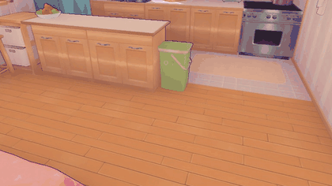<br><b>미니 미타 · 지능 체크</b><br>보기에서 답을 고르는 퀴즈를 냅니다.</td>
</tr>
</table>

---

## 교감 메뉴

미타에게 가까이 가서 테두리가 표시되면 **E** 키로 메뉴를 엽니다. 메뉴는 원작 3장에서 미타와 대화할 때 나오는 선택지 목록이며, 숫자 키나 마우스로 고릅니다.

### 대화하기

<table>
<tr>
<td align="center">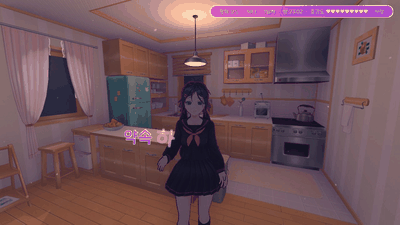<br><b>아무 이야기나</b><br>시간대와 호감도에 따라 주제가 달라지고, 말하는 동안 자기 챕터의 몸짓을 합니다.</td>
<td align="center"><br><b>질문하기</b><br>좋아하는 음식, 취미, 다른 미타들, 처음 만났을 때, 꿈… 10가지 질문에 미타마다 다르게 대답합니다. "나 좋아해?"의 대답은 호감도에 따라 바뀝니다.</td>
</tr>
</table>

- **자유롭게 말하기** — 로컬 AI 모델로 자유 대화 ([AI 자유 대화](#ai-자유-대화), 기본은 꺼져 있음)

### 교감하기

<table>
<tr>
<td align="center">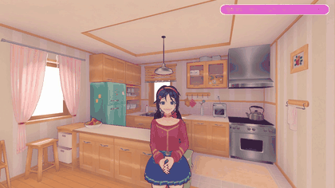<br><b>쓰다듬기</b><br>호감도 단계마다 반응이 다르고, 사이가 나쁘면 거절합니다.</td>
<td align="center">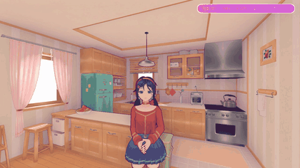<br><b>안아 주기</b><br>원작 엔딩의 포옹 애니메이션입니다.</td>
<td align="center"><br><b>칭찬하기</b><br>단계별로 다른 대사로 쑥스러워합니다.</td>
</tr>
<tr>
<td align="center">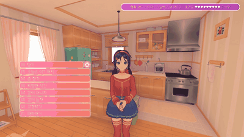<br><b>안경 써 줘</b><br>원작 3장의 미타 안경을 씌우고 벗깁니다(밀라 · 미니 미타 제외).</td>
<td align="center">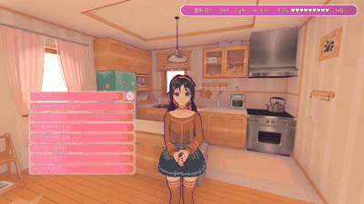<br><b>옷 갈아입기</b><br>원조 미타만. 원작 '의상'의 교복 3색이고 다음 접속에도 유지됩니다.</td>
<td align="center">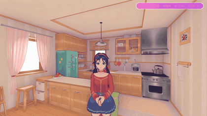<br><b>손 잡기</b><br>미치광이 미타의 고유 행동. 백룸의 손 잡기 동작으로, 잡는 동안 시선이 미타에게 고정됩니다.</td>
</tr>
</table>

### 선물하기

<table>
<tr>
<td align="center">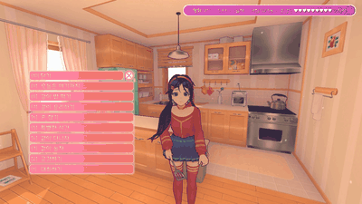<br><b>좋아하는 선물</b><br>꽃 · 초콜릿 · 책 · 커피 · 인형 · 카세트 테이프 중에서 고릅니다. 미타마다 제일 좋아하는 것이 있고 호감도가 많이 오릅니다.</td>
<td align="center">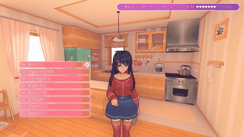<br><b>미타마다 다른 반응</b><br>착한 미타는 커피, 밀라는 책, 캐피는 카세트 테이프… 시큰둥한 선물도 하나씩 있습니다.</td>
<td align="center">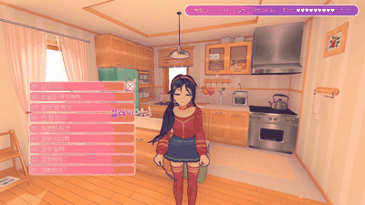<br><b>같은 선물을 또 주면</b><br>하루에 같은 선물을 두 번 주면 한마디 합니다. 선물은 종류마다 게임 속 하루에 한 번씩 셉니다.</td>
</tr>
</table>

- 사이가 나쁠 때는 받긴 하지만 별로 풀리지 않습니다.
- 다음 날 아침 인사 때 어제 받은 선물 이야기를 꺼냅니다(좋아하는 선물이면 따로).
- 호감도 7단계부터는 가끔 미타가 먼저 자기 선물을 건넵니다 ([미타가 먼저](#미타가-먼저)).

### 같이 놀자

<table>
<tr>
<td align="center">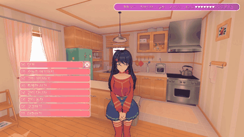<br><b>가위바위보</b><br>이기고 지면 원작의 반응 동작을 합니다.</td>
<td align="center">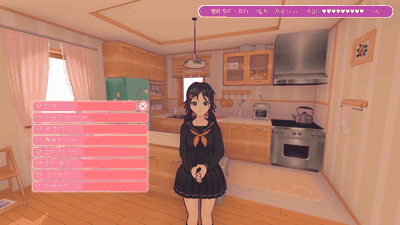<br><b>끝말잇기</b><br>미타가 말한 단어에 이어지는 단어를 세 개 중에서 고릅니다. 틀리면 미타의 승리.</td>
<td align="center">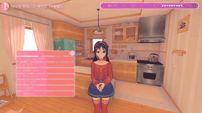<br><b>넌센스 퀴즈</b><br>보기 중에서 답을 고릅니다. (끝말잇기와 퀴즈는 한국어 말장난이라 다른 언어에서도 한국어로 나옵니다.)</td>
</tr>
<tr>
<td align="center">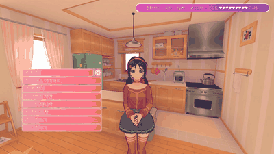<br><b>참참참</b><br>"참!"에 미타가 고개를 돌린 쪽과 반대로 시점을 돌리면 피한 것. 세 판 중 두 번 피하면 승리.</td>
<td align="center">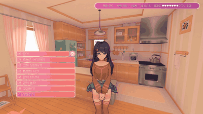<br><b>숨바꼭질</b><br>화면이 어두워진 사이 미타가 집 어딘가에 숨습니다. 2분 30초 안에 찾아 가까이 가면 됩니다.</td>
<td align="center"><br><b>같이 사진 찍기</b><br>미타가 포즈를 잡고, 사진은 게임 폴더 <code>PeaceModePhotos/</code>에 저장됩니다.</td>
</tr>
<tr>
<td align="center">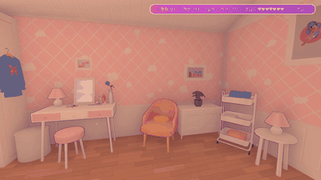<br><b>카드 게임</b><br>침실 테이블의 원작 4장 카드 게임 그대로. 몇 번이든 다시 할 수 있고, 테이블에는 고른 미타가 앉습니다.</td>
<td align="center" colspan="2"><b>TV 게임기</b><br>거실 소파의 원작 TV 게임기도 그대로 동작합니다. 끄면 미타가 카드 게임을 권합니다.</td>
</tr>
</table>

### 캐피의 미니게임

캐피를 골랐을 때 "같이 놀자"에 두 가지가 더 있습니다. 원작 7장 "캐피와 시간 보내기"의 게임을 그대로 가져와 우리 집에 놓았고, 대사도 원작 대사라 게임의 모든 언어로 나옵니다.

<table>
<tr>
<td align="center">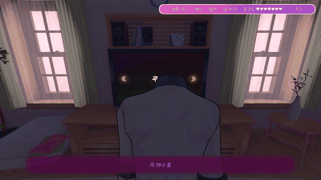<br><b>댄스 배틀 · 곡 고르기와 캐피의 차례</b><br>거실 TV 앞에 댄스 패드가 깔리고 TV에서 리듬 게임이 열립니다. 곡을 고르면 캐피가 먼저 춥니다.</td>
<td align="center">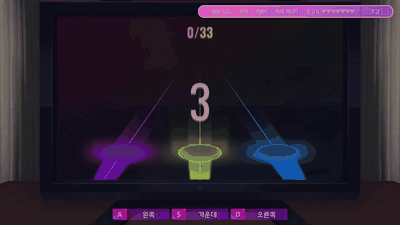<br><b>댄스 배틀 · 내 차례와 결과</b><br>A · S · D 키로 리듬을 맞춥니다. 점수를 비교해 캐피가 한마디 하고 "한 판 더?"를 묻습니다(최대 세 곡).</td>
</tr>
<tr>
<td align="center">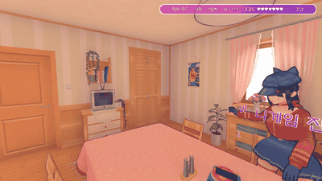<br><b>망치 게임 · 자리에 앉아 규칙 설명</b><br>부엌 식탁에 버튼과 장난감 망치가 놓입니다. 처음 할 때만 캐피가 규칙을 설명합니다.</td>
<td align="center">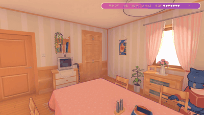<br><b>망치 게임 · 한 판</b><br>신호가 뜨면 먼저 버튼을 누른 쪽이 이기고, 진 쪽이 망치로 한 대 맞습니다. 이기면 "가볍게 / 세게"를 고르고, 하트는 서로 3개입니다.</td>
</tr>
</table>

### 같이 다니자

<div align="center">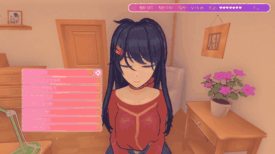<br><b>같이 다니자</b><br>방을 옮기면 미타가 뒤따라옵니다. "여기서 기다려"로 그만둡니다.</div>

### 특별한 시간

호감도가 오르면 차례로 열립니다(15 · 20 · 30 · 45 · 70).

<table>
<tr>
<td align="center">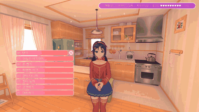<br><b>같이 창밖 보기</b><br>거실 창가에 나란히 섭니다. 낮과 밤의 대사가 다릅니다.</td>
<td align="center">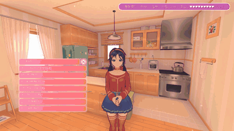<br><b>비 · 눈 오는 날의 창밖</b><br>비가 오거나 눈이 내리면 그날만의 대사가 나옵니다.</td>
<td align="center">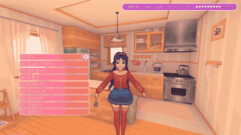<br><b>같이 음악 듣기</b><br>침실의 카세트 플레이어 앞에 나란히 서서, 집 음악이 커진 채로 미타의 이야기를 듣습니다.</td>
</tr>
<tr>
<td align="center">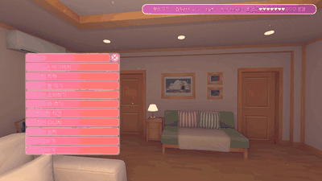<br><b>무릎베개</b><br>소파에 앉은 미타의 무릎에 누운 시점으로 잠깐 눈을 붙입니다.</td>
<td align="center">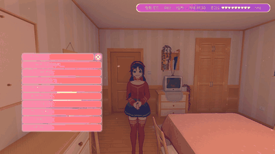<br><b>노래 불러 줘</b><br>미타마다 다른 노래를 부릅니다. 그동안 배경 음악이 멈춥니다.</td>
<td align="center">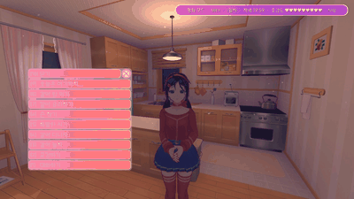<br><b>속마음 듣기</b><br>처음 들을 때와 다시 들을 때의 대사가 다릅니다.</td>
</tr>
</table>

---

## 몸짓과 시선

<table>
<tr>
<td align="center">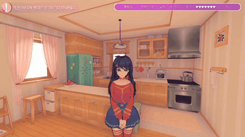<br><b>오래 쳐다보면 부끄러워함</b><br>얼굴을 오래 쳐다보면 원작처럼 시선을 피하고, 계속 쳐다보면 한마디 합니다.</td>
<td align="center">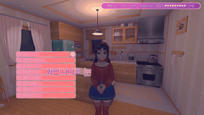<br><b>작별 인사</b><br>메뉴의 "오늘은 여기까지…"로 나가면 손을 흔들며 인사합니다.</td>
</tr>
</table>

- 미타는 말할 때 자기 챕터의 몸짓을 합니다. 착한 미타는 손가락으로 가리키거나 생각에 잠기고, 캐피는 웃거나 폴짝 뛰고, 밀라는 방을 가리키거나 뒤를 돌아보고, 잠꾸러기 미타는 하품을 하고, 단발 미타는 강의하듯 손짓합니다.
- 가까이 있으면 플레이어를 눈으로 좇고, 뒤로 돌아가면 몸을 돌립니다. 다가가서 쳐다보면 돌아다니다가도 멈춰서 기다립니다.
- 다른 방에 오래 있으면 가끔 미타가 찾아옵니다.

---

## 집 안 물건 · 부탁 · 일기

<table>
<tr>
<td align="center">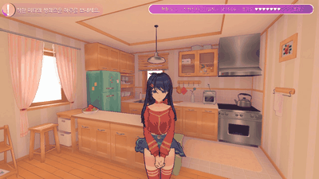<br><b>집 안 물건</b><br>22곳에 가까이 가서 테두리와 이름이 보일 때 누르면 미타가 와서 그 물건 이야기를 합니다. 전부 둘러보면 "집 구경 완료" 대사가 나옵니다.</td>
<td align="center">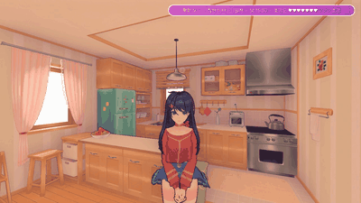<br><b>미타의 부탁</b><br>가끔 머리 위에 <b>?</b>가 뜨고 "냉장고에서 우유 좀 가져다줄래요?" 같은 부탁을 합니다. 물건을 누른 뒤 돌아가 말을 걸면 호감도가 오르고, 잊어버리면 서운해합니다.</td>
<td align="center">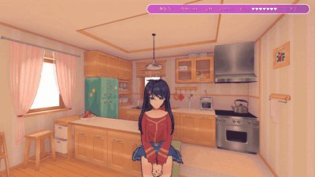<br><b>오늘 하루 일기</b><br>밤에 같이 잠들기 전, 그날 같이 한 일(식사, 요리, 놀이, 선물, 음악, 집 구경, 부탁…)을 자기 말투로 정리해 줍니다.</td>
</tr>
</table>

- 물건: 원작 4장의 사진 · 시계 · 운동화 · 거울 · 현관문, 원작 3장의 책장 · 배전함 · 우산꽂이 · 작은 TV · 컴퓨터 · 피규어 · 교복, 그리고 냉장고 · 주전자 · 곰 인형 · 카세트 플레이어 · 달 조명 · 선인장 · 스피커 · 고무 오리 · 욕실 거울. 미치광이 미타는 원작에 대사가 있는 물건이면 원작 대사를 그대로 합니다.

---

## 미타가 먼저

<table>
<tr>
<td align="center">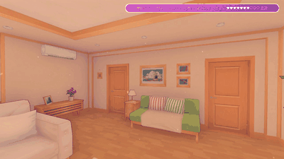<br><b>미타의 제안</b><br>혼잣말 대신 가끔 먼저 뭔가 하자고 합니다: 대화, 놀이, 사진, 창밖 보기, 같이 다니기, 식사 시간엔 요리, 밤엔 잠, 고유 행동, 소파에서 TV · 책 · 휴식, 캐피는 댄스 배틀과 망치 게임까지. "좋아 / 지금은 좀…"으로 대답합니다.</td>
<td align="center">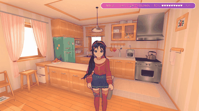<br><b>미타의 선물</b><br>호감도 7단계부터, 하루 한 번 미타가 먼저 자기 선물을 건넵니다. 미치광이 미타는 접은 종이 하트, 착한 미타는 직접 깎은 톱니바퀴 열쇠고리, 캐피는 기타 피크…</td>
</tr>
</table>

- 호감도가 높으면 더 자주 묻고, 사이가 나쁘면 묻지 않습니다. 다른 방에 있다가 미타가 찾아왔을 때도 제안을 들고 오는 일이 많습니다.

---

## 호감도

<table>
<tr>
<td align="center">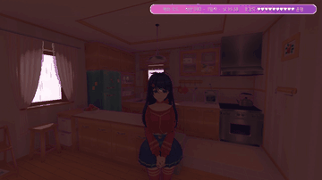<br><b>호감도가 오를 때</b><br>단계가 바뀌면 미타가 그 변화에 대해 한마디 합니다. 가장 높은 단계와 가장 낮은 단계에는 따로 대사가 있습니다.</td>
<td align="center">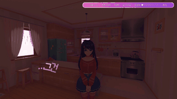<br><b>사이가 나쁠 때</b><br>혼잣말, 아침 인사, 쳐다봤을 때의 반응이 차가워지고, 쓰다듬기와 안기를 거절합니다.</td>
<td align="center">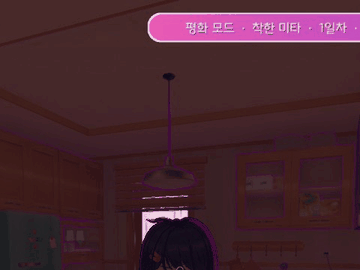<br><b>경멸하는 표정</b><br>1 · 2단계에서는 원작에 없는 표정을 얼굴 블렌드셰이프로 만들어 짓습니다.</td>
</tr>
</table>

호감도는 10단계로 나뉘고, 화면 오른쪽 위에 하트 10칸과 단계 이름으로 표시됩니다.

| 단계 | 1 | 2 | 3 | 4 | 5 | 6 | 7 | 8 | 9 | 10 |
|---|---|---|---|---|---|---|---|---|---|---|
| 이름 | 최악 | 싫음 | 냉랭 | 낯섦 | 친근 | 친함 | 호감 | 좋아함 | 사랑 | 운명 |

- 대화, 교감, 선물, 놀이, 식사 등을 하면 오르고, 미타를 서운하게 하면 내려갑니다: Alt+F4로 끄기, 창 닫기 버튼으로 끄기, 이틀 넘게 안 오기, 미타가 차린 밥이 식을 때까지 안 오기, 부탁 잊어버리기, 자는 미타 깨우기.
- **8~10단계** — 더 자주 찾아오고, 쳐다보면 더 빨리 부끄러워하며, 미타가 선물을 건넵니다.
- 미타마다 말투가 달라서 단계별 대사도 미타마다 따로 있습니다.

---

## 하루 일과

<table>
<tr>
<td align="center">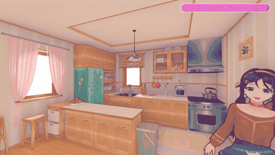<br><b>같이 밥 먹기</b><br>아침 7~10시, 점심 11:30~14시, 저녁 17:30~20:30에 한 번씩. 원작 3장의 식탁 세트를 가져와 의자에 앉아 <b>먹기</b> 키로 먹으며 대화합니다. 미타도 맞은편에 앉아 포크로 같이 먹습니다.</td>
<td align="center">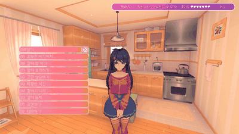<br><b>같이 요리하기</b><br>미타는 스토브에서 뒤집개로 프라이팬을 볶고(원작 3장 동작), 플레이어는 원작 3장의 당근 썰기를 합니다. 다 썰면 그대로 식사로 이어집니다.</td>
<td align="center">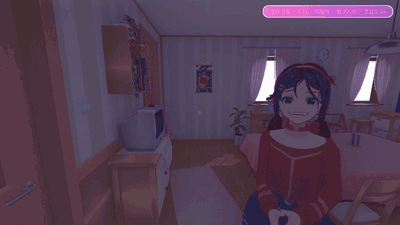<br><b>같이 잠자기</b><br>밤에 고르면 침대에 나란히 누워 마주 보고 인사를 나눈 뒤 다음 날 아침으로 넘어갑니다. 누운 자세는 잠꾸러기 미타의 잠 애니메이션이고, 잠들면 눈을 감습니다.</td>
</tr>
</table>

- 게임 내 시간이 흐르며(아침 · 낮 · 저녁 · 밤) 조명, 음악, 대사가 바뀝니다. 밤에는 창밖이 어두워지고 램프와 천장등이 켜지며, 음악도 시간대마다 다른 곡 · 빠르기로 바뀝니다.
- **미타의 하루** — 식사 시간이 되면 스스로 부엌에 가서 요리를 시작하고(머리 위 **!**), 다 되면 식탁으로 부릅니다. 취침 시각에는 먼저 침대에 가서 눕습니다(**z**). 자고 있는 미타에게는 같이 자기 · 깨우기 · 그냥 두기를 고를 수 있습니다. 잠꾸러기 미타는 낮잠도 가능합니다.
- 원작 3장 씬에서 요리 코너와 식탁 세트를 빌려 오느라 처음 한 번은 화면이 몇 초 어두워집니다.

---

## 소파

<table>
<tr>
<td align="center">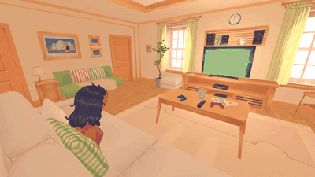<br><b>같이 TV 보기</b><br>TV가 켜지고 화면 빛이 방에 비칩니다. 시선은 TV를 보다가 미타가 말할 때 그쪽으로 돌아갑니다.</td>
<td align="center">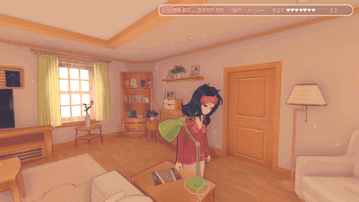<br><b>책 읽어 주기</b><br>미타가 책을 들고 읽어 줍니다.</td>
<td align="center">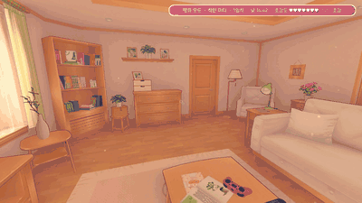<br><b>같이 쉬기</b><br>미타가 꾸벅꾸벅 졸기 시작합니다.</td>
</tr>
</table>

<div align="center">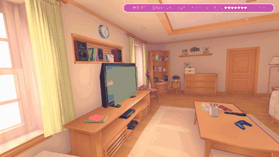<br><b>옆에 앉기</b><br>미타는 낮에 한가하면 가끔 혼자 소파에 가서 책을 보거나 TV를 보거나 낮잠을 잡니다(잠꾸러기 미타는 자주). 그때 말을 걸면 메뉴에 "옆에 앉기"가 생깁니다.</div>

플레이어는 원작 3장의 의자에 앉는 동작을 소파에 맞춰 쓰고, 미타는 원작의 앉기 동작(잠꾸러기 미타 · 엔딩 장면에서 가져옴)으로 옆자리에 앉습니다.

---

## 날씨와 계절

<table>
<tr>
<td align="center"><br><b>비</b><br>창밖에 비가 내리고 빗소리가 들립니다. 하늘이 회색이 되고 햇빛이 약해집니다.</td>
<td align="center"><br><b>눈 (겨울)</b><br>겨울에는 눈이 내립니다.</td>
<td align="center"><br><b>계절마다 다른 빛</b><br>봄은 분홍빛, 여름은 밝고 해가 길고, 가을은 금빛, 겨울은 푸르스름하고 해가 짧습니다.</td>
</tr>
</table>

- 계절은 현실 달력을 따릅니다. 날마다 계절에 맞게 맑음 · 흐림 · 비 · 눈이 정해지고, 오후에 가끔 바뀝니다.
- 아침 인사와 혼잣말에 그날 날씨 · 계절 이야기가 섞이고, 날씨가 바뀌면 미타가 알아챕니다. 창밖 보기에도 비 · 눈 전용 대사가 있습니다.

---

## 현실 연동 이벤트

미타가 게임 밖의 상황에 반응합니다.

<table>
<tr>
<td align="center"><br><b>종료 방식</b><br>메뉴에서 정상 종료, 메인 메뉴로 나가기, Alt+F4, 창 닫기 버튼, 비정상 종료(튕김 · 작업 관리자)를 구분해 다음 실행 때 반응합니다. Alt+F4는 반복할수록 반응이 강해지고 호감도도 내려갑니다.</td>
<td align="center"><br><b>요일 · 생일 · 기념일</b><br>월요일 · 금요일 · 주말에 그날 처음 들어가면 요일 이야기를 하고, 설정의 <code>Birthday</code>에 적은 날에는 축하해 주며, 처음 들어온 날부터 7 · 30 · 100 · 365 · 730일째에는 기념 대사가 나옵니다.</td>
</tr>
<tr>
<td align="center"><br><b>노트북 배터리</b><br>전원을 뽑은 채 배터리가 20% 아래로 내려가면 충전기를 꽂으라고 하고, 7% 아래면 한 번 더 다급하게 말합니다. 배터리가 없는 PC에서는 아무 일도 없습니다.</td>
<td align="center"><br><b>사진 수</b><br>같이 찍은 사진이 10 · 30 · 100 · 300장이 되면 사진을 찍고 나서 한마디 합니다.</td>
</tr>
</table>

- **접속 간격** — 마지막 접속으로부터 지난 시간(몇 분 / 몇 시간 / 하루 / 며칠 / 일주일 이상)과 접속 시각(새벽 · 이른 아침)에 따라 첫인사가 달라집니다.
- **플레이 중 행동** — Alt+Tab 후 복귀, 자리 비움(4분), 스크린샷 키(F12 · PrtSc), 창 모드 · 크기 변경, ESC 일시 정지 · 사진 모드, 소리 끄기, 미타를 오래 쳐다보기, 휴대용 게임기 꺼내기.
- **현실 시간** — 연속 플레이 1 · 2 · 3시간, 실제 새벽 시간대, 게임 시간과 실제 시간의 낮 · 밤이 반대일 때, 연속 접속 일수, 누적 접속 횟수, 누적 플레이 시간.
- **현실 날짜** — 1/1, 2/14, 3/14, 4/1, 10/31, 11/11, 12/11(MiSide 출시일), 12/24, 12/25, 12/31.
- **게임 종료 메뉴** — 교감 메뉴의 "오늘은 여기까지…" → "게임 종료"를 고르면 미타가 손을 흔들며 인사한 뒤 게임이 종료됩니다.

---

## 착한 미타의 본편 기억

<div align="center"><br><b>본편 기억</b></div>

착한 미타만, 게임의 세이브 폴더(업적 · 챕터 세이브 · 이어하기 지점)를 읽어서(쓰지는 않음) 본편을 어디까지 했는지 압니다.

- 아직 시작 전 / 초반 / 지하에서 만난 뒤 / 끝까지 본 뒤에 따라 첫 인사가 달라집니다(단계마다 한 번).
- 받아 둔 업적('당근', '게임 고인물', '위대한 춤', '찾았다!', '머리 톡톡!' 등 20종)에 대해 한 세션에 하나씩 이야기합니다.

---

## 캐피 이스터에그

<div align="center"><br><b>고개 따라 하기</b><br>캐피 앞에서 마우스로 시선을 위아래로 흔들면 캐피가 고개를 끄덕이고, 좌우로 흔들면 고개를 젓습니다.</div>

---

## 언어

<div align="center"><br><b>영어 · 일본어 · 중국어</b></div>

평화 모드의 대사, 메뉴, 화면 표시는 한국어, 영어, 일본어, 중국어(간체)로 나옵니다. 기본은 게임 언어를 따르고(한국어 · 일본어 · 중국어는 그대로, 그 밖의 언어는 영어), 설정 파일의 `Language`로 고를 수 있습니다. 게임 언어와 다르게 일본어나 중국어를 고르면 말풍선에 게임의 일본어 · 중국어 글꼴을 씁니다. 끝말잇기 단어와 일부 넌센스 퀴즈처럼 한국어 말장난인 부분은 한국어 그대로 나옵니다.

---

## AI 자유 대화

대화하기 → **자유롭게 말하기**를 고르면 화면 아래 입력창에 미타에게 할 말을 직접 쓸 수 있습니다(한글 입력 가능, Enter로 보내기, 빈 칸 Enter나 Esc로 끝내기). 대답은 **내 PC에서 돌아가는 AI 모델**이 미타가 되어 만듭니다. 인터넷 서비스는 쓰지 않습니다.

- 미타마다 성격 · 말투 · 원작 설정을 적은 캐릭터 시트가 있고, 지금 시각 · 호감도 · 미타가 하고 있는 일 · 오늘 같이 한 일도 함께 알려 줍니다.
- 대답 앞의 표정 태그로 미타의 표정이 바뀝니다. 최근 대화 40개를 미타별로 기억합니다(`BepInEx/config/MiSidePeaceMode_<미타>.chat.txt`).
- 필요한 것: OpenAI 방식 채팅 API를 제공하는 로컬 AI 서버(Ollama, llama.cpp 서버, LM Studio 등)와 대화할 언어를 잘하는 모델. 설정 파일 `BepInEx/config/kr.miside.peacemode.cfg`의 `[AiChat]`에서 `Enabled = true`, `Endpoint`, `Model`을 맞춥니다.
- 서버가 없거나 응답이 없으면 미타가 "머리가 멍하다"고 하고 대화가 닫힙니다.

---

## 설치

| | |
|---|---|
| 게임 | MiSide (Steam) 0.93L |
| 운영 체제 | Windows 10 / 11 (64비트) |
| 모드 로더 | [BepInEx-Unity.IL2CPP-win-x64-6.0.0-pre.2](https://github.com/BepInEx/BepInEx/releases/tag/v6.0.0-pre.2) |

### 자동 설치 (권장)


1. [Releases](https://github.com/O3O-2022/MiSide-PeaceMode/releases/latest)에서 **`MiSidePeaceMode-Setup-vX.Y.Z.exe`** 를 받아 실행합니다.
2. 게임 폴더는 Steam 라이브러리에서 자동으로 찾습니다. **설치**를 누르면 BepInEx(모드 로더)가 없을 때 BepInEx 공식 릴리스에서 내려받아 넣고, 모드와 실행용 배치 파일을 게임 폴더에 넣습니다.
3. **게임 실행** 버튼이나 바탕 화면의 바로 가기로 게임을 켭니다 → 메인 메뉴 → 평화 모드 → 미타 선택. BepInEx를 처음 넣은 뒤 첫 실행은 몇 분 걸립니다.

- **언어:** 한국어 · English · 日本語 · 简体中文 · 繁體中文 · Русский · Español · Português · Deutsch · Français. Windows 표시 언어에 맞춰 고르고, 오른쪽 위에서 바꿀 수 있습니다.
- **Windows의 PC 보호(SmartScreen)** 창이 뜨면 "추가 정보" → "실행"을 누릅니다. 코드 서명이 없는 프로그램이라 뜨는 경고입니다. 꺼려지면 아래의 수동 설치를 쓰세요. 설치 프로그램의 소스는 [`tools/installer`](tools/installer)에 있습니다.
- **인터넷 없이 설치:** BepInEx zip(`BepInEx-Unity.IL2CPP-win-x64-6.0.0-pre.2.zip`)을 설치 프로그램과 같은 폴더에 두면 내려받지 않고 그 파일을 씁니다.
- **모드 제거** 버튼은 모드와 배치 파일, 바로 가기만 지웁니다. BepInEx와 세이브는 그대로 둡니다.
- 창 없이 설치: `MiSidePeaceMode-Setup-vX.Y.Z.exe /install "X:\...\MiSide"` (제거는 `/uninstall`).

### 수동 설치

1. **BepInEx 넣기** — 위 BepInEx zip을 게임 폴더(`...\steamapps\common\MiSide`, `MiSideFull.exe`가 있는 곳)에 풀고, 게임을 한 번 실행했다가 메인 메뉴에서 종료합니다. 첫 실행은 몇 분 걸립니다.
2. **모드 넣기** — [Releases](https://github.com/O3O-2022/MiSide-PeaceMode/releases/latest)에서 `MiSidePeaceMode-vX.Y.Z.zip`을 받아 같은 게임 폴더에 풉니다. `BepInEx\plugins\MiSidePeaceMode.dll`과 `MiSide Peace Mode.bat`이 생깁니다.
3. **실행** — 게임 폴더의 **`MiSide Peace Mode.bat`** 로 게임을 켭니다 → 메인 메뉴 → 평화 모드 → 미타 선택.

지우려면 `BepInEx\plugins\MiSidePeaceMode.dll`을 지우면 됩니다. 본편 세이브는 건드리지 않습니다.

> **왜 배치 파일로 켜나요?** 2026-10 Steam 클라이언트에서는 Steam으로 실행하면 Steam 오버레이가 모드 로더(doorstop)보다 먼저 붙어 BepInEx가 시작되지 않는 경우가 있습니다(메인 메뉴에 평화 모드 버튼이 없고 `BepInEx/LogOutput.log`가 갱신되지 않음). 배치 파일은 Steam이 꺼져 있으면 켠 뒤 게임을 직접 실행합니다(`steam_appid.txt`를 만들어 Steam이 게임을 다시 띄우지 않게 함). Steam에서 바로 실행하고 싶으면 MiSide 속성에서 **"게임 중 Steam 오버레이 사용"을 끄면** 됩니다.

<details><summary>소스에서 직접 빌드하기</summary>

.NET SDK 6 이상이 필요합니다. BepInEx를 넣고 게임을 한 번 실행한 뒤, 이 저장소 폴더에서:

```powershell
powershell -ExecutionPolicy Bypass -File deploy.ps1
```

모드를 빌드해 `BepInEx/plugins`에 설치하고 배치 파일을 게임 폴더에 복사합니다. 게임 폴더는 Steam 라이브러리에서 자동으로 찾고, 못 찾으면 `-GameDir "X:\...\MiSide"`로 지정합니다.

</details>

## 조작 · 설정

| 키 | 동작 |
|---|---|
| **E** | 미타 가까이에서 교감 메뉴 열기 |
| **1~9**, **0** / 마우스 | 메뉴 선택 (10번째 항목은 0) |
| **E** / **ESC** / 우클릭 | 메뉴 닫기 |
| 메뉴 → 오늘은 여기까지… | 메인 메뉴로 / 게임 종료 |

미타의 대사는 분홍색으로 미타 옆에, 플레이어(나)의 대사는 **흰색으로 화면 아래쪽**에 나옵니다.

설정 파일 `BepInEx/config/kr.miside.peacemode.cfg`

| 항목 | 설명 |
|---|---|
| `InteractKey` | 교감 키 (기본 E) |
| `TimeScale` | 게임 시간 흐름 속도 (1 = 현실 1초에 게임 1분) |
| `ShowHud` | 화면 오른쪽 위 상태 표시 (일차 · 시간 · 호감도) |
| `PlayerName` | 미타가 부르는 이름. 비워 두면 1장에서 입력한 이름, 없으면 '플레이어' |
| `Birthday` | 내 생일 `MM-dd` (예: `03-14`). 그날 미타가 축하해 줍니다. 비워 두면 없음 |
| `Language` | `auto`(게임 언어를 따름), `ko`, `en`, `ja`, `zh` |
| `[AiChat]` | AI 자유 대화 (위 참고) |

- 진행도: `BepInEx/config/MiSidePeaceMode*.save` (미타별). 파일을 지우면 처음부터 시작합니다.
- 평화 모드는 본편 세이브를 수정하지 않습니다(읽기만 합니다).

---

## English · 日本語 · 中文

**English** — A BepInEx 6 (IL2CPP) plugin for MiSide 0.93L. The main menu's "Peaceful Mode" button starts a day with one of seven Mitas without the horror: talking, touches, gifts, games, meals, the sofa, music and sleep, with animations borrowed from across the story, ten steps of affection that also go down, and reactions to what you do outside the game (Alt+F4, being away, the real date, your laptop's battery). Kind Mita remembers how far you got in the main story. The mod's lines and menus follow the game language (Korean, English, Japanese, Simplified Chinese), or set `Language` in `BepInEx/config/kr.miside.peacemode.cfg`. 

**Install (English)** — download **`MiSidePeaceMode-Setup-vX.Y.Z.exe`** from [Releases](https://github.com/O3O-2022/MiSide-PeaceMode/releases/latest) and run it. It finds the game folder, downloads BepInEx (the mod loader) from BepInEx's own release page if it is missing, copies the mod in, and can start the game. The installer speaks Korean, English, Japanese, Simplified and Traditional Chinese, Russian, Spanish, Portuguese, German and French. It is not code-signed, so Windows SmartScreen may ask: "More info" → "Run anyway". The first start after BepInEx goes in takes a few minutes. Start the game with the installer's button, the desktop shortcut or `MiSide Peace Mode.bat` in the game folder (started straight from Steam, the overlay can keep the mod loader from starting).<br>
By hand instead: 1) extract [BepInEx 6 IL2CPP pre.2](https://github.com/BepInEx/BepInEx/releases/tag/v6.0.0-pre.2) into the game folder and start the game once; 2) extract `MiSidePeaceMode-vX.Y.Z.zip` from Releases into the same folder; 3) start the game with `MiSide Peace Mode.bat`.


**日本語** — MiSide 0.93L 用の BepInEx 6 (IL2CPP) プラグインです。メインメニューの「ピースフル・モード」から、7人のミタの誰かとホラー展開なしで一日を過ごせます（会話、ふれあい、プレゼント、遊び、食事、ソファ、音楽、睡眠）。セリフとメニューはゲームの言語に合わせて表示され、設定ファイルの `Language` で `ja` を選ぶこともできます。**インストール:** [Releases](https://github.com/O3O-2022/MiSide-PeaceMode/releases/latest) から `MiSidePeaceMode-Setup-vX.Y.Z.exe` をダウンロードして実行し、「インストール」を押すだけです（ゲームフォルダーの検出、BepInEx のダウンロード、MODのコピーまで自動。日本語表示に対応）。その後は「ゲームを起動」ボタンかデスクトップのショートカットで起動してください。

**中文** — 适用于 MiSide 0.93L 的 BepInEx 6 (IL2CPP) 插件。在主菜单的"和平模式"中选择七位米塔之一，在没有恐怖剧情的情况下与她共度一天（聊天、互动、送礼、游戏、吃饭、沙发、听音乐、睡觉）。台词和菜单跟随游戏语言显示，也可以在配置文件中把 `Language` 设为 `zh`。**安装：** 从 [Releases](https://github.com/O3O-2022/MiSide-PeaceMode/releases/latest) 下载 `MiSidePeaceMode-Setup-vX.Y.Z.exe` 并运行，点击“安装”即可（自动查找游戏文件夹、下载 BepInEx、复制模组，支持简体/繁体中文界面）。之后请用“启动游戏”按钮或桌面快捷方式启动游戏。

---

## 개발자용

| 경로 | 내용 |
|---|---|
| `PeaceMode/` | 평화 모드 BepInEx 플러그인 (C#, .NET 6 / IL2CPP) |
| `lang/` | 영어 · 일본어 · 중국어 번역(`<code>.json`, 한국어 원문 → 번역)과 번역 도구 `build.py` · `extract.py` |
| `tools/make_gif.py` | 캡처 프레임으로 GIF 만들기 |
| `tools/make_video.py` | 녹화 프레임으로 영상(MJPEG AVI) 만들기 (ffmpeg 불필요) |
| `tools/recording/` | README GIF 재촬영 스크립트(`record_*.txt`, DevRunner 녹화 명령)와 GIF 빌드(`build_media.py`) |
| `tools/video/` | 소개 영상 파이프라인 (4K60 · 게임 소리 포함 녹화, 유튜브 자막 33개 언어) |
| `tools/regression_v4.txt` | 회귀 테스트 스크립트 |
| `docs/media/` | README용 GIF · 이미지 |
| `tools/installer/` | 플레이어용 설치 프로그램 (WinForms, Windows에 들어 있는 C# 컴파일러로 빌드: `build.py`) |
| `tools/make_release.py` | 릴리스 파일 만들기 (설치 프로그램 exe + 수동 설치용 zip) |
| `deploy.ps1` | 모드 빌드/설치 |

- **테스트 자동화:** `BepInEx/config/peacemode_dev.txt`에 명령을 적고 `PeaceMode/run_dev.ps1`을 실행합니다 (명령은 `PeaceMode/DevRunner.cs`의 `Run`에 있습니다). 테스트 중에는 본편 세이브와 평화 모드 세이브를 스냅샷했다가 복원합니다. **직접 플레이하기 전에 `peacemode_dev.txt`를 지우세요** (자동 실행 후 게임을 종료합니다).

### 진행 상황

- [x] 평화 모드: 공포 이벤트 차단, 시간대 · 조명, 교감 메뉴, 호감도 10단계
- [x] 미타 7명 (외형 교체, 머리카락/치마 물리, 대기 모션, 목소리 높낮이, 고유 행동, 좋아하는 선물)
- [x] 식사, 요리, 잠자기, 낮잠, 소파, 날씨와 계절
- [x] 선물하기 · 미타의 선물 · 같이 음악 듣기 · 특별한 시간
- [x] 현실 연동 이벤트 (접속 간격, 종료 방식, 플레이 중 행동, 현실 시간 · 날짜, 요일 · 생일 · 기념일, 배터리, 사진 수)
- [x] 착한 미타의 본편 기억
- [x] 스토리 미니게임 재활용: 원작 3장의 당근 썰기 · 식탁 세트, 4장의 카드 게임 · TV 게임기, 7장의 댄스 배틀 · 망치 게임
- [x] 한국어 · 영어 · 일본어 · 중국어
- [ ] 러시아어 · 우크라이나어 · 독일어 · 프랑스어 등 나머지 언어 (각 170문장만 돼 있음)
- [ ] 다른 미타들의 옷 갈아입기, 설정 UI, 사진 앨범
