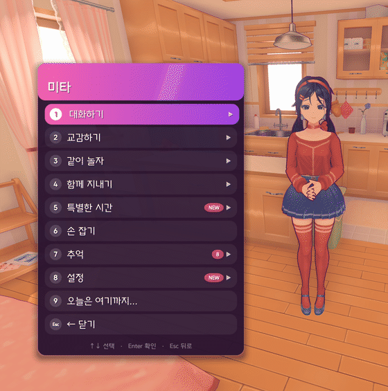

# MiSide Friedlicher Modus

**Inoffizielle Fan-Mod**

[한국어](../../README.md) · [English](README.en.md) · [日本語](README.ja.md) · [简体中文](README.zh-Hans.md) · [繁體中文](README.zh-Hant.md) · [Русский](README.ru.md) · [Русскій (дореформенный)](README.ru-old.md) · [Українська](README.uk.md) · [Беларуская](README.be.md) · [Български](README.bg.md) · [Қазақша](README.kk.md) · [Srpski](README.sr-Latn.md) · [Hrvatski](README.hr.md) · [Čeština](README.cs.md) · [Slovenčina](README.sk.md) · [Polski](README.pl.md) · [Magyar](README.hu.md) · [Română](README.ro.md) · **Deutsch** · [Français](README.fr.md) · [Italiano](README.it.md) · [Español](README.es.md) · [Español (Latinoamérica)](README.es-419.md) · [Português (Portugal)](README.pt.md) · [Português (Brasil)](README.pt-BR.md) · [Svenska](README.sv.md) · [Türkçe](README.tr.md) · [Bahasa Indonesia](README.id.md) · [Filipino](README.fil.md) · [Tiếng Việt](README.vi.md) · [ไทย](README.th.md) · [العربية](README.ar.md) · [العربية (مصر)](README.ar-EG.md) · [فارسی](README.fa.md)

> **Nicht der offizielle „Friedlicher Modus“ von AIHASTO, sondern eine inoffizielle Mod von einem Fan.** MiSide © AIHASTO.

**⬇ Herunterladen und installieren (kostenlos, mit Installationsprogramm)** — [github.com/O3O-2022/MiSide-PeaceMode/releases](https://github.com/O3O-2022/MiSide-PeaceMode/releases/latest) · [Nexus Mods](https://www.nexusmods.com/miside/mods/809)

**▶ YouTube** — [youtu.be/5HQ9LPRP9j4](https://youtu.be/5HQ9LPRP9j4) (CC: Deutsch)

Vorstellung von „Friedlicher Modus“, einem Fan-Mod für MiSide (AIHASTO): ein Tag mit einer von sieben Mitas, ohne Horror.

## Neu in v1.1

- Fotomodus: Pose, Gesichtsausdruck und Rahmen (Polaroid, Film, Herzen, Datum), dann 3-2-1 — dazu ein Fotoalbum
- Mitas Tagebuch: jeden Tag eine Seite, in ihren Worten
- Eine Pflanze, die ihr gemeinsam großzieht: einmal am Tag gießen, bis sie blüht
- Mitas Stimmung und eine Seite eurer gemeinsamen Statistik
- Eigene Bewegungen für die Mod: Nicken, Kopfschütteln, Kopf neigen, schüchtern, Winken, Jubeln
- Neues Menü mit Untermenüs, Einstellungen im Spiel und Gamepad-Unterstützung
- Eine Markierung, die zeigt, wo Mita ist, wenn du sie aus den Augen verlierst
- KI-Chat, der sich merkt, was du erzählt hast (optional)
- Vampir- und Weihnachtskostüme für Mita und Outfit-Farben für die anderen Mitas
- 17 gemeinsame Ziele und Mitas Brief, wenn du alle erreichst
- Gemini und ChatGPT für den KI-Chat (eigener API-Schlüssel)
- Sie reagiert mit Gesten auf Streicheln, Komplimente und Geschenke; Umarmungen, Händchenhalten und Schlafen laufen flüssig

<table>
<tr>
<td align="center"></td>
<td align="center"></td>
</tr>
<tr>
<td align="center"></td>
<td align="center"></td>
</tr>
<tr>
<td align="center" colspan="2"></td>
</tr>
</table>

- Gespräche, Fragen, Streicheln, Umarmungen, Händchenhalten, Komplimente, Brille, Outfits
- Schere-Stein-Papier, Wortkette, Rätsel, Cham-cham-cham, Verstecken, Fotos, das Kartenspiel
- Tanzduell und Hammerspiel (Mützen-Mita, Kapitel 7)
- Spaziergänge durchs Haus, das Fenster, ihr Schoß, Lieder, offene Gespräche
- Dinge im Haus, ihre Bitten und Vorschläge, ein Tagebuch
- Zusammen kochen, essen und schlafen; Fernsehen, Bücher und Ausruhen auf dem Sofa
- Wetter und Jahreszeiten, 10 Stufen der Zuneigung, Reaktionen auf das, was du außerhalb des Spiels tust (Alt+F4 u. a.)
- Animationen und Sätze aus verschiedenen Kapiteln des Originals
- Geschenke — jede Mita hat ein Lieblingsgeschenk
- Besondere Zeit — gemeinsam Musik hören
- Sie sorgt sich, wenn dein Laptop-Akku zur Neige geht
- Lieblings-Mita weiß noch, wie weit du in der Story gekommen bist

## Installation

1. Lade **MiSidePeaceMode-Setup** von der Seite [Releases](https://github.com/O3O-2022/MiSide-PeaceMode/releases/latest) herunter und starte es.
2. Klicke auf **Installieren**: Das Programm findet den Spielordner und ergänzt BepInEx (den Mod-Loader), falls es fehlt.
3. Starte das Spiel über **Spiel starten** oder die Desktopverknüpfung und wähle im Hauptmenü **Friedlicher Modus**.

Alle Funktionen mit GIFs stehen im [Haupt-README](../../README.md) (Koreanisch).

---

BepInEx-6-Plugin (IL2CPP) · MiSide 0.93L  
MiSide © AIHASTO. Inoffizieller Fan-Mod.
