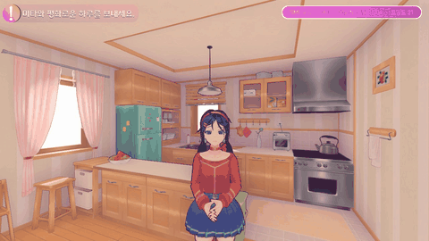
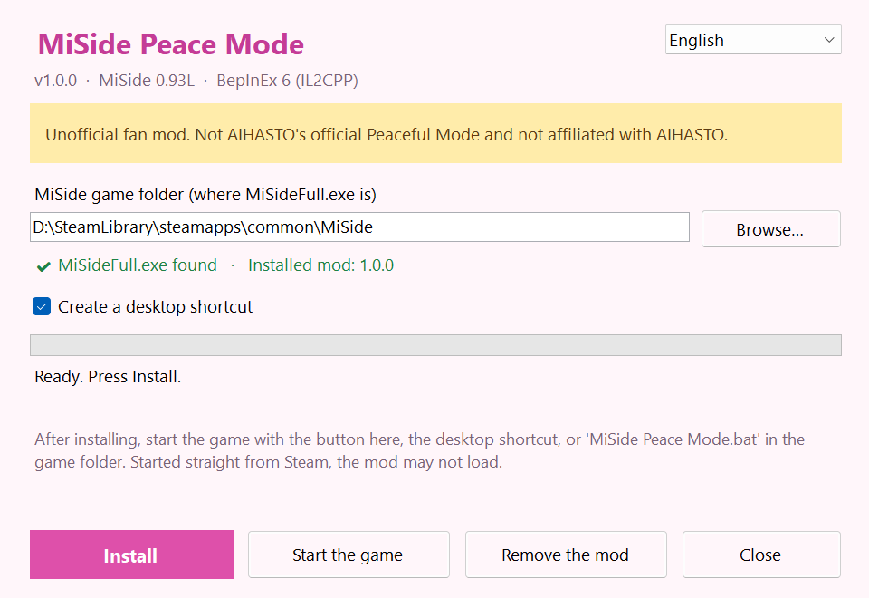

# MiSide Peaceful Mode

**Unofficial fan mod**

[한국어](../../README.md) · **English** · [日本語](README.ja.md) · [简体中文](README.zh-Hans.md) · [繁體中文](README.zh-Hant.md) · [Русский](README.ru.md) · [Русскій (дореформенный)](README.ru-old.md) · [Українська](README.uk.md) · [Беларуская](README.be.md) · [Български](README.bg.md) · [Қазақша](README.kk.md) · [Srpski](README.sr-Latn.md) · [Hrvatski](README.hr.md) · [Čeština](README.cs.md) · [Slovenčina](README.sk.md) · [Polski](README.pl.md) · [Magyar](README.hu.md) · [Română](README.ro.md) · [Deutsch](README.de.md) · [Français](README.fr.md) · [Italiano](README.it.md) · [Español](README.es.md) · [Español (Latinoamérica)](README.es-419.md) · [Português (Portugal)](README.pt.md) · [Português (Brasil)](README.pt-BR.md) · [Svenska](README.sv.md) · [Türkçe](README.tr.md) · [Bahasa Indonesia](README.id.md) · [Filipino](README.fil.md) · [Tiếng Việt](README.vi.md) · [ไทย](README.th.md) · [العربية](README.ar.md) · [العربية (مصر)](README.ar-EG.md) · [فارسی](README.fa.md)

> **Not AIHASTO's official 'Peaceful Mode': an unofficial mod made by a fan.** MiSide © AIHASTO.

**⬇ Download and install (free, with an installer)** — [github.com/O3O-2022/MiSide-PeaceMode/releases](https://github.com/O3O-2022/MiSide-PeaceMode/releases/latest)

**▶ YouTube** — [youtu.be/mswlea_Ozpg](https://youtu.be/mswlea_Ozpg) (CC: English)

An introduction to 'Peaceful Mode', a fan-made mod for MiSide (AIHASTO): spend a day with one of seven Mitas, with no horror.

- Talk, questions, head pats, hugs, holding hands, compliments, glasses, outfits
- Rock-paper-scissors, word chain, riddles, cham-cham-cham, hide and seek, photos, the card game
- Cappie's dance battle and hammer game (from chapter 7)
- Walks around the house, the window, a lap pillow, songs, heart-to-heart talks
- Things around the house, her favours and suggestions, a daily diary
- Cooking, meals and sleeping together; TV, books and naps on the sofa
- Weather and seasons, ten levels of affection, reactions to what you do outside the game (Alt+F4 and more)
- Built from the game's own animations and lines across its chapters
- Gifts — every Mita has a favourite
- Special time — listening to music together
- She worries when your laptop battery runs low
- Kind Mita remembers how far you got in the story

## Install

1. Download **MiSidePeaceMode-Setup** from [Releases](https://github.com/O3O-2022/MiSide-PeaceMode/releases/latest) and run it.
2. Press **Install**: it finds the game folder and adds BepInEx (the mod loader) if it is missing.
3. Start the game with **Start the game** or the desktop shortcut, then pick **Peaceful Mode** in the main menu.

Every feature, with a GIF each, is in the [main README](../../README.md) (Korean).

---

BepInEx 6 (IL2CPP) plugin · MiSide 0.93L  
MiSide © AIHASTO. This is an unofficial fan mod.
