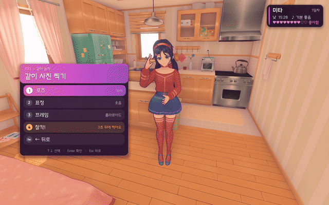

# MiSide Miran način igranja

**Neslužbeni fanovski mod**

[한국어](../../README.md) · [English](README.en.md) · [日本語](README.ja.md) · [简体中文](README.zh-Hans.md) · [繁體中文](README.zh-Hant.md) · [Русский](README.ru.md) · [Русскій (дореформенный)](README.ru-old.md) · [Українська](README.uk.md) · [Беларуская](README.be.md) · [Български](README.bg.md) · [Қазақша](README.kk.md) · [Srpski](README.sr-Latn.md) · **Hrvatski** · [Čeština](README.cs.md) · [Slovenčina](README.sk.md) · [Polski](README.pl.md) · [Magyar](README.hu.md) · [Română](README.ro.md) · [Deutsch](README.de.md) · [Français](README.fr.md) · [Italiano](README.it.md) · [Español](README.es.md) · [Español (Latinoamérica)](README.es-419.md) · [Português (Portugal)](README.pt.md) · [Português (Brasil)](README.pt-BR.md) · [Svenska](README.sv.md) · [Türkçe](README.tr.md) · [Bahasa Indonesia](README.id.md) · [Filipino](README.fil.md) · [Tiếng Việt](README.vi.md) · [ไทย](README.th.md) · [العربية](README.ar.md) · [العربية (مصر)](README.ar-EG.md) · [فارسی](README.fa.md)

> **Ovo nije službeni „Miran način igranja“ studija AIHASTO, nego neslužbeni mod koji je izradio fan.** MiSide © AIHASTO.

**⬇ Preuzimanje i instalacija (besplatno, s instalacijskim programom)** — [github.com/O3O-2022/MiSide-PeaceMode/releases](https://github.com/O3O-2022/MiSide-PeaceMode/releases/latest)

**▶ YouTube** — [youtu.be/5HQ9LPRP9j4](https://youtu.be/5HQ9LPRP9j4) (CC: Hrvatski)

Predstavljamo „Miran način igranja“, fanovski mod za MiSide (AIHASTO): dan s jednom od sedam Mita, bez horora.

## Novo u v1.1

- Foto način: poza, izraz lica i okvir (polaroid, film, srca, datum), zatim 3-2-1 — i foto album
- Mitin dnevnik: stranica za svaki dan, njezinim riječima
- Biljka koju uzgajate zajedno: zalijevajte je jednom dnevno i procvjetat će
- Mitino raspoloženje i stranica vaših zajedničkih zapisa
- Pokreti izrađeni za mod: kimanje, odmahivanje, naginjanje glave, sramežljivost, mahanje, „ura“
- Novi izbornik s podizbornicima, postavke u igri i podrška za gamepad
- Oznaka koja pokazuje gdje je Mita kad je izgubite iz vida
- AI razgovor koji pamti što ste joj rekli (po želji)
- Vampirske i božićne odjeće za Mitu te boje odjeće za ostale Mite
- 17 ciljeva za zajedničko ostvarenje i Mitino pismo kad ih sve ispuniš
- Gemini i ChatGPT za AI chat (vlastiti API ključ)
- Gestama reagira na maženje, komplimente i darove; zagrljaji, držanje za ruke i spavanje teku glatko

<table>
<tr>
<td align="center"></td>
<td align="center"></td>
</tr>
<tr>
<td align="center"></td>
<td align="center"></td>
</tr>
<tr>
<td align="center" colspan="2"></td>
</tr>
</table>

- Razgovor, pitanja, maženje, zagrljaji, držanje za ruke, pohvale, naočale, odjeća
- Kamen-škare-papir, igra riječi, zagonetke, čam-čam-čam, skrivača, fotografije, kartaška igra
- Plesni dvoboj i igra s čekićem (Mita s kapom, 7. poglavlje)
- Šetnje po kući, prozor, glava u krilu, pjesme, iskreni razgovori
- Stvari u kući, njezine molbe i prijedlozi, dnevnik
- Kuhanje, obroci i spavanje zajedno; TV, knjige i odmor na kauču
- Vrijeme i godišnja doba, 10 razina naklonosti, reakcije na ono što radite izvan igre (Alt+F4 i drugo)
- Animacije i replike iz raznih poglavlja originala
- Darovi — svaka Mita ima omiljeni
- Posebno vrijeme — zajedničko slušanje glazbe
- Brine se kad baterija prijenosnika oslabi
- Ljubazna Mita pamti dokle ste stigli u priči

## Instalacija

1. Preuzmite **MiSidePeaceMode-Setup** sa stranice [Releases](https://github.com/O3O-2022/MiSide-PeaceMode/releases/latest) i pokrenite ga.
2. Kliknite **Install**: program pronalazi mapu igre i dodaje BepInEx (učitavač modova) ako ga nema.
3. Pokrenite igru gumbom **Start the game** ili prečacem na radnoj površini te odaberite **Miran način igranja** u glavnom izborniku.

Sve značajke s GIF-ovima nalaze se u [glavnom README](../../README.md) (na korejskom).

---

BepInEx 6 (IL2CPP) dodatak · MiSide 0.93L  
MiSide © AIHASTO. Neslužbeni fanovski mod.
