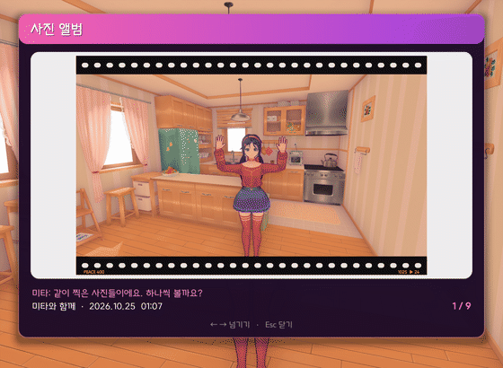

# MiSide Tryb pokojowy

**Nieoficjalny mod fanowski**

[한국어](../../README.md) · [English](README.en.md) · [日本語](README.ja.md) · [简体中文](README.zh-Hans.md) · [繁體中文](README.zh-Hant.md) · [Русский](README.ru.md) · [Русскій (дореформенный)](README.ru-old.md) · [Українська](README.uk.md) · [Беларуская](README.be.md) · [Български](README.bg.md) · [Қазақша](README.kk.md) · [Srpski](README.sr-Latn.md) · [Hrvatski](README.hr.md) · [Čeština](README.cs.md) · [Slovenčina](README.sk.md) · **Polski** · [Magyar](README.hu.md) · [Română](README.ro.md) · [Deutsch](README.de.md) · [Français](README.fr.md) · [Italiano](README.it.md) · [Español](README.es.md) · [Español (Latinoamérica)](README.es-419.md) · [Português (Portugal)](README.pt.md) · [Português (Brasil)](README.pt-BR.md) · [Svenska](README.sv.md) · [Türkçe](README.tr.md) · [Bahasa Indonesia](README.id.md) · [Filipino](README.fil.md) · [Tiếng Việt](README.vi.md) · [ไทย](README.th.md) · [العربية](README.ar.md) · [العربية (مصر)](README.ar-EG.md) · [فارسی](README.fa.md)

> **To nie jest oficjalny „Tryb pokojowy” od AIHASTO, lecz nieoficjalny mod stworzony przez fana.** MiSide © AIHASTO.

**⬇ Pobierz i zainstaluj (za darmo, z instalatorem)** — [github.com/O3O-2022/MiSide-PeaceMode/releases](https://github.com/O3O-2022/MiSide-PeaceMode/releases/latest)

**▶ YouTube** — [youtu.be/5HQ9LPRP9j4](https://youtu.be/5HQ9LPRP9j4) (CC: Polski)

Prezentacja „Tryb pokojowy”, fanowskiego moda do MiSide (AIHASTO): dzień z jedną z siedmiu Mit, bez horroru.

## Nowości w v1.1

- Tryb zdjęć: poza, mina i ramka (polaroid, film, serduszka, data), potem 3-2-1 — i album ze zdjęciami
- Pamiętnik Mity: strona na każdy dzień, jej słowami
- Roślinka, którą hodujecie razem: podlewaj raz dziennie, a zakwitnie
- Nastrój Mity i strona waszych wspólnych zapisków
- Ruchy zrobione dla moda: kiwnięcie, kręcenie głową, przechylenie głowy, nieśmiałość, machanie, „hura”
- Nowe menu z podmenu, ustawienia w grze i obsługa pada
- Znacznik pokazujący, gdzie jest Mita, gdy stracisz ją z oczu
- Czat AI, który pamięta, co mu powiedziałeś (opcjonalnie)
- Stroje wampira i świąteczne dla Mity oraz kolory ubrań dla pozostałych Mit
- 17 celów do osiągnięcia razem i list od Mity, gdy zaliczysz wszystkie
- Gemini i ChatGPT do czatu AI (własny klucz API)
- Gestami reaguje na głaskanie, komplementy i prezenty; przytulanie, trzymanie za ręce i spanie działają płynnie

<table>
<tr>
<td align="center"></td>
<td align="center"></td>
</tr>
<tr>
<td align="center"></td>
<td align="center"></td>
</tr>
<tr>
<td align="center" colspan="2"></td>
</tr>
</table>

- Rozmowy, pytania, głaskanie, przytulanie, trzymanie za ręce, pochwały, okulary, stroje
- Kamień-papier-nożyce, łańcuch słów, zagadki, czam-czam-czam, chowany, zdjęcia, gra w karty
- Taneczna bitwa i gra z młotkiem (Czapcia, 7. rozdział)
- Spacery po domu, okno, kolana, piosenki, szczere rozmowy
- Rzeczy w domu, jej prośby i propozycje, dziennik
- Gotowanie, posiłki i sen razem; telewizja, książki i odpoczynek na kanapie
- Pogoda i pory roku, 10 poziomów sympatii, reakcje na to, co robisz poza grą (Alt+F4 i inne)
- Animacje i kwestie z różnych rozdziałów oryginału
- Prezenty — każda Mita ma swój ulubiony
- Wyjątkowe chwile — wspólne słuchanie muzyki
- Martwi się, gdy w laptopie kończy się bateria
- Uprzejma Mita pamięta, jak daleko zaszedłeś w fabule

## Instalacja

1. Pobierz **MiSidePeaceMode-Setup** ze strony [Releases](https://github.com/O3O-2022/MiSide-PeaceMode/releases/latest) i uruchom.
2. Kliknij **Install**: program znajdzie folder gry i doda BepInEx (program ładujący mody), jeśli go brakuje.
3. Uruchom grę przyciskiem **Start the game** lub skrótem na pulpicie i wybierz **Tryb pokojowy** w menu głównym.

Wszystkie funkcje z GIF-ami są w [głównym README](../../README.md) (po koreańsku).

---

Wtyczka BepInEx 6 (IL2CPP) · MiSide 0.93L  
MiSide © AIHASTO. Nieoficjalny mod fanowski.
