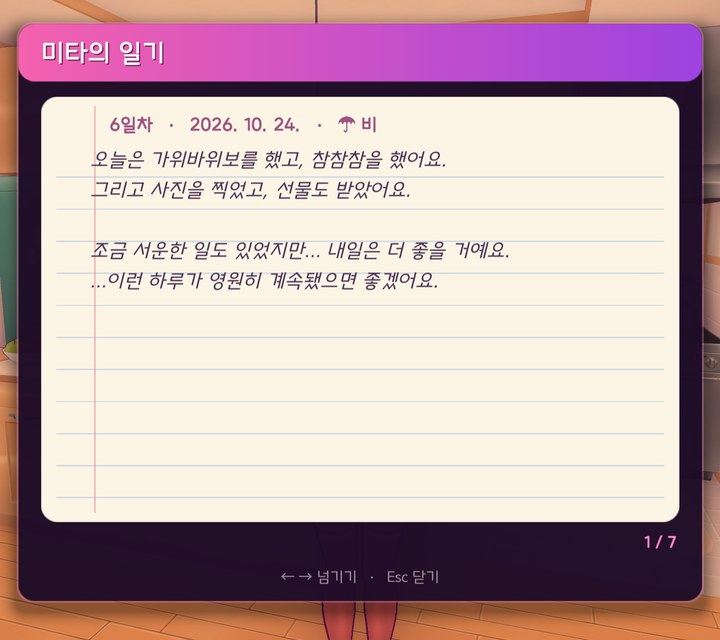

# MiSide Мирный режимъ

**Неофиціальная любительская передѣлка**

[한국어](../../README.md) · [English](README.en.md) · [日本語](README.ja.md) · [简体中文](README.zh-Hans.md) · [繁體中文](README.zh-Hant.md) · [Русский](README.ru.md) · **Русскій (дореформенный)** · [Українська](README.uk.md) · [Беларуская](README.be.md) · [Български](README.bg.md) · [Қазақша](README.kk.md) · [Srpski](README.sr-Latn.md) · [Hrvatski](README.hr.md) · [Čeština](README.cs.md) · [Slovenčina](README.sk.md) · [Polski](README.pl.md) · [Magyar](README.hu.md) · [Română](README.ro.md) · [Deutsch](README.de.md) · [Français](README.fr.md) · [Italiano](README.it.md) · [Español](README.es.md) · [Español (Latinoamérica)](README.es-419.md) · [Português (Portugal)](README.pt.md) · [Português (Brasil)](README.pt-BR.md) · [Svenska](README.sv.md) · [Türkçe](README.tr.md) · [Bahasa Indonesia](README.id.md) · [Filipino](README.fil.md) · [Tiếng Việt](README.vi.md) · [ไทย](README.th.md) · [العربية](README.ar.md) · [العربية (مصر)](README.ar-EG.md) · [فارسی](README.fa.md)

> **Это не офиціальный «Мирный режимъ» отъ AIHASTO, а неофиціальная передѣлка, сдѣланная любителемъ.** MiSide © AIHASTO.

**⬇ Скачать и установить (безплатно, съ установщикомъ)** — [github.com/O3O-2022/MiSide-PeaceMode/releases](https://github.com/O3O-2022/MiSide-PeaceMode/releases/latest) · [Nexus Mods](https://www.nexusmods.com/miside/mods/809)

**▶ YouTube** — [youtu.be/5HQ9LPRP9j4](https://youtu.be/5HQ9LPRP9j4) (CC: Русскій (дореформенный))

Знакомство съ «Мирный режимъ» — любительской передѣлкой для MiSide (AIHASTO): день съ одной изъ семи Митъ, безъ ужасовъ.

## Новое въ v1.1

- Фоторежимъ: поза, выраженіе лица и рамка (полароидъ, плёнка, сердечки, дата), затѣмъ 3-2-1 — и фотоальбомъ
- Дневникъ Миты: страница за каждый день, ея словами
- Цвѣтокъ, который вы растите вмѣстѣ: поливайте разъ въ день — и онъ зацвѣтётъ
- Настроеніе Миты и страница вашихъ общихъ достиженій
- Движенія, сдѣланныя для мода: кивокъ, «нѣтъ», наклонъ головы, смущеніе, взмахъ рукой, «ура»
- Новое меню съ подменю, настройки въ игрѣ и поддержка геймпада
- Мѣтка, показывающая, гдѣ Мита, когда вы её потеряли изъ виду
- ИИ-чатъ, который помнитъ, что вы разсказали (по желанію)
- Костюмы вампира и Рождества для Миты и смена цвета одежды у остальных Мит
- 17 целей, которых нужно достичь вместе, и письмо Миты, когда выполнишь все
- Gemini и ChatGPT для ИИ-чата (свой API-ключ)
- Она реагирует жестами на поглаживания, комплименты и подарки; объятия, руки и сон работают плавно

<table>
<tr>
<td align="center"></td>
<td align="center"></td>
</tr>
<tr>
<td align="center"></td>
<td align="center"></td>
</tr>
<tr>
<td align="center" colspan="2"></td>
</tr>
</table>

- Разговоры, вопросы, поглаживанія, объятія, прогулки за руку, похвала, очки, наряды
- Камень-ножницы-бумага, игра въ слова, загадки, чамъ-чамъ-чамъ, прятки, карточки, карточная игра
- Танцовальная битва и игра съ молоткомъ (Мита Кепочка, 7-я глава)
- Прогулки по дому, видъ изъ окна, колѣни, пѣсни, задушевныя бесѣды
- Предметы въ домѣ, ея просьбы и предложенія, дневникъ дня
- Стряпаемъ, ѣдимъ и спимъ вмѣстѣ; телевизоръ, книги и отдыхъ на диванѣ
- Погода и времена года, 10 ступеней симпатіи, отвѣты на ваши дѣйствія внѣ игры (Alt+F4 и пр.)
- Движенія и реплики изъ разныхъ главъ подлинника
- Подарки — у каждой Миты свой любимый
- Особое время — слушать музыку вмѣстѣ
- Она волнуется, когда у ноутбука садится батарея
- Мита добрая помнитъ, какъ далеко вы прошли сюжетъ

## Установка

1. Скачайте **MiSidePeaceMode-Setup** со страницы [Releases](https://github.com/O3O-2022/MiSide-PeaceMode/releases/latest) и запустите.
2. Нажмите **Установить**: программа найдетъ папку игры и добавитъ BepInEx (загрузчикъ модовъ), если его нѣтъ.
3. Запустите игру кнопкой **Запустить игру** или ярлыкомъ на рабочемъ столѣ и выберите **Мирный режимъ** въ главномъ меню.

Всѣ возможности съ GIF — въ [основномъ README](../../README.md) (на корейскомъ).

---

Дополненіе BepInEx 6 (IL2CPP) · MiSide 0.93L  
MiSide © AIHASTO. Неофиціальная любительская передѣлка.
