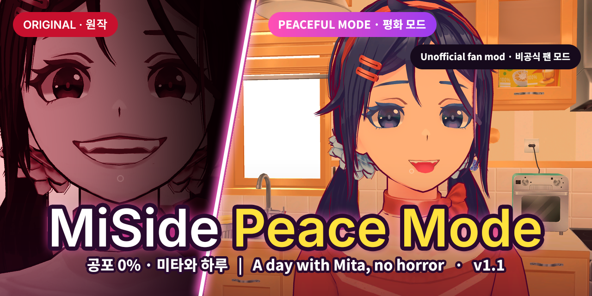

# MiSide Mirni mod

**Nezvanični fanovski mod**

[한국어](../../README.md) · [English](README.en.md) · [日本語](README.ja.md) · [简体中文](README.zh-Hans.md) · [繁體中文](README.zh-Hant.md) · [Русский](README.ru.md) · [Русскій (дореформенный)](README.ru-old.md) · [Українська](README.uk.md) · [Беларуская](README.be.md) · [Български](README.bg.md) · [Қазақша](README.kk.md) · **Srpski** · [Hrvatski](README.hr.md) · [Čeština](README.cs.md) · [Slovenčina](README.sk.md) · [Polski](README.pl.md) · [Magyar](README.hu.md) · [Română](README.ro.md) · [Deutsch](README.de.md) · [Français](README.fr.md) · [Italiano](README.it.md) · [Español](README.es.md) · [Español (Latinoamérica)](README.es-419.md) · [Português (Portugal)](README.pt.md) · [Português (Brasil)](README.pt-BR.md) · [Svenska](README.sv.md) · [Türkçe](README.tr.md) · [Bahasa Indonesia](README.id.md) · [Filipino](README.fil.md) · [Tiếng Việt](README.vi.md) · [ไทย](README.th.md) · [العربية](README.ar.md) · [العربية (مصر)](README.ar-EG.md) · [فارسی](README.fa.md)

> **Ovo nije zvanični „Mirni mod“ studija AIHASTO, već nezvanični mod koji je napravio fan.** MiSide © AIHASTO.

**⬇ Preuzimanje i instalacija (besplatno, sa instalerom)** — [github.com/O3O-2022/MiSide-PeaceMode/releases](https://github.com/O3O-2022/MiSide-PeaceMode/releases/latest)

**▶ YouTube** — [youtu.be/5HQ9LPRP9j4](https://youtu.be/5HQ9LPRP9j4) (CC: Srpski)

Predstavljamo „Mirni mod“, fanovski mod za MiSide (AIHASTO): dan sa jednom od sedam Mita, bez horora.

## Novo u v1.1

- Foto režim: poza, izraz lica i okvir (polaroid, film, srca, datum), pa 3-2-1 — i foto album
- Mitin dnevnik: stranica za svaki dan, njenim rečima
- Biljka koju gajite zajedno: zalivajte je jednom dnevno i procvetaće
- Mitino raspoloženje i stranica vaših zajedničkih zapisa
- Pokreti napravljeni za mod: klimanje, odmahivanje, naginjanje glave, stidljivost, mahanje, „ura“
- Novi meni sa podmenijima, podešavanja u igri i podrška za gamepad
- Oznaka koja pokazuje gde je Mita kada je izgubite iz vida
- AI ćaskanje koje pamti šta ste joj rekli (po želji)
- Vampirske i božićne odeće za Mitu i boje odeće za ostale Mite
- 17 ciljeva za zajedničko ostvarenje i Mitino pismo kad ih sve ispuniš
- Gemini i ChatGPT za AI četovanje (sopstveni API ključ)
- Gestovima reaguje na maženje, komplimente i poklone; zagrljaji, držanje za ruke i spavanje teku glatko

<table>
<tr>
<td align="center"></td>
<td align="center"></td>
</tr>
<tr>
<td align="center"></td>
<td align="center"></td>
</tr>
<tr>
<td align="center" colspan="2"></td>
</tr>
</table>

- Razgovor, pitanja, maženje, zagrljaji, držanje za ruke, pohvale, naočare, odeća
- Kamen-papir-makaze, igra reči, zagonetke, čam-čam-čam, žmurke, fotografije, igra kartama
- Plesni duel i igra sa čekićem (Mita sa kapom, 7. poglavlje)
- Šetnje po kući, prozor, glava u krilu, pesme, iskreni razgovori
- Stvari u kući, njene molbe i predlozi, dnevnik
- Kuvanje, obroci i spavanje zajedno; TV, knjige i odmor na kauču
- Vreme i godišnja doba, 10 nivoa naklonosti, reakcije na ono što radite van igre (Alt+F4 i drugo)
- Animacije i replike iz raznih poglavlja originala
- Pokloni — svaka Mita ima omiljeni
- Posebno vreme — zajedničko slušanje muzike
- Brine se kad baterija laptopa oslabi
- Ljubazna Mita pamti dokle ste stigli u priči

## Instalacija

1. Preuzmite **MiSidePeaceMode-Setup** sa stranice [Releases](https://github.com/O3O-2022/MiSide-PeaceMode/releases/latest) i pokrenite ga.
2. Kliknite na **Install**: program pronalazi folder igre i dodaje BepInEx (učitavač modova) ako ga nema.
3. Pokrenite igru dugmetom **Start the game** ili prečicom na radnoj površini i izaberite **Mirni mod** u glavnom meniju.

Sve funkcije sa GIF-ovima su u [glavnom README](../../README.md) (na korejskom).

---

BepInEx 6 (IL2CPP) dodatak · MiSide 0.93L  
MiSide © AIHASTO. Nezvanični fanovski mod.
