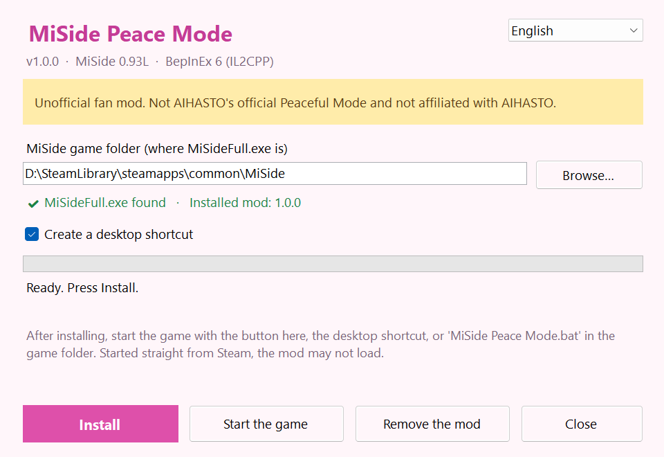

# MiSide 和平模式

**非官方粉絲模組**

[한국어](../../README.md) · [English](README.en.md) · [日本語](README.ja.md) · [简体中文](README.zh-Hans.md) · **繁體中文** · [Русский](README.ru.md) · [Русскій (дореформенный)](README.ru-old.md) · [Українська](README.uk.md) · [Беларуская](README.be.md) · [Български](README.bg.md) · [Қазақша](README.kk.md) · [Srpski](README.sr-Latn.md) · [Hrvatski](README.hr.md) · [Čeština](README.cs.md) · [Slovenčina](README.sk.md) · [Polski](README.pl.md) · [Magyar](README.hu.md) · [Română](README.ro.md) · [Deutsch](README.de.md) · [Français](README.fr.md) · [Italiano](README.it.md) · [Español](README.es.md) · [Español (Latinoamérica)](README.es-419.md) · [Português (Portugal)](README.pt.md) · [Português (Brasil)](README.pt-BR.md) · [Svenska](README.sv.md) · [Türkçe](README.tr.md) · [Bahasa Indonesia](README.id.md) · [Filipino](README.fil.md) · [Tiếng Việt](README.vi.md) · [ไทย](README.th.md) · [العربية](README.ar.md) · [العربية (مصر)](README.ar-EG.md) · [فارسی](README.fa.md)

> **這不是AIHASTO官方的「和平模式」，而是粉絲製作的非官方模組.** MiSide © AIHASTO.

**⬇ 下載與安裝（免費，附安裝程式）** — [github.com/O3O-2022/MiSide-PeaceMode/releases](https://github.com/O3O-2022/MiSide-PeaceMode/releases/latest) · [Nexus Mods](https://www.nexusmods.com/miside/mods/809)

**▶ YouTube** — [youtu.be/5HQ9LPRP9j4](https://youtu.be/5HQ9LPRP9j4) (CC: 繁體中文)

介紹 MiSide（AIHASTO）的粉絲自製模組「和平模式」：沒有恐怖劇情，與七位米塔之一共度一天。

## v1.1 新功能

- 拍照模式：選擇姿勢、表情和相框（拍立得、底片、愛心、日期戳），3·2·1 喀嚓，還有相簿
- 米塔的日記：每天一頁，用她的口吻寫下
- 一起養的盆栽：每天澆一次水，會開出花來
- 米塔的心情，以及兩人的紀錄
- 為本模組製作的動作：點頭、搖頭、歪頭、害羞、揮手、歡呼（配合台詞）
- 帶子選單的新選單、遊戲內設定、手把支援
- 看不到米塔時顯示她位置的標記
- 會記住你說過的話的 AI 聊天（可選）
- 米塔的吸血鬼與聖誕服裝，以及其他米塔的服裝換色
- 17個共同達成的目標，全部完成後收到米塔的信
- AI聊天支援Gemini和ChatGPT（使用你自己的API金鑰）
- 對摸頭、稱讚和禮物用動作回應，擁抱、牽手和睡覺更流暢

<table>
<tr>
<td align="center"></td>
<td align="center"></td>
</tr>
<tr>
<td align="center"></td>
<td align="center"></td>
</tr>
<tr>
<td align="center" colspan="2"></td>
</tr>
</table>

- 聊天、提問、摸頭、擁抱、牽手、稱讚、眼鏡、換裝
- 剪刀石頭布、詞語接龍、腦筋急轉彎、啪啪啪、捉迷藏、拍照、紙牌遊戲
- 帽子米塔的鬥舞與槌子遊戲（原作第7章）
- 一起走、看窗外、膝枕、唱歌、心裡話
- 家中物品、米塔的請求與提議、今日日記
- 一起做飯、吃飯、睡覺；沙發上看電視、讀書、休息
- 天氣與季節、10級好感度、對遊戲外行為的反應（Alt+F4 等）
- 運用原作各章節的動畫與台詞
- 送禮物 — 每位米塔喜歡的禮物都不同
- 特別時光 — 一起聽音樂
- 筆電電量不足時，她會為你擔心
- 善良米塔記得你主線玩到了哪裡

## 安裝

1. 從 [Releases](https://github.com/O3O-2022/MiSide-PeaceMode/releases/latest) 下載 **MiSidePeaceMode-Setup** 並執行。
2. 按下 **安裝**：它會找到遊戲資料夾，若沒有 BepInEx（模組載入器）會自動裝好。
3. 用 **啟動遊戲** 按鈕或桌面捷徑啟動遊戲，然後在主選單選擇 **和平模式**。

每個功能的 GIF 示範請見[主 README](../../README.md)（韓文）。

---

BepInEx 6 (IL2CPP) 外掛 · MiSide 0.93L  
MiSide © AIHASTO。這是非官方粉絲模組。
